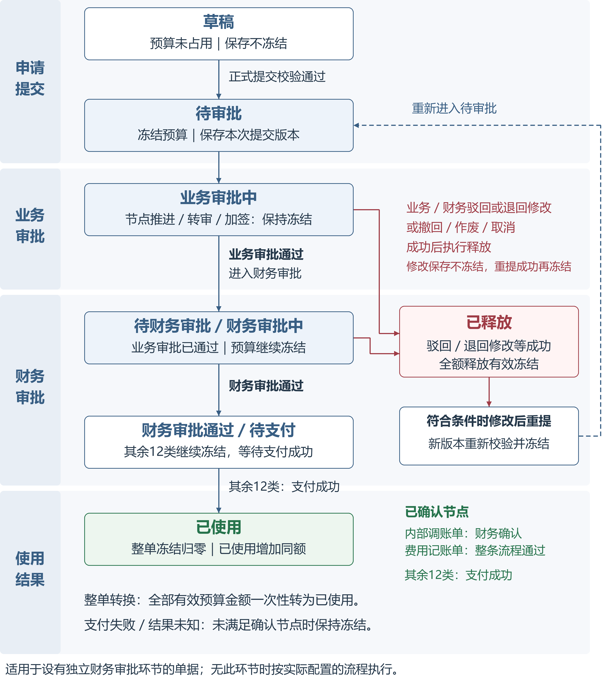

# ERP I003 预算优化详细需求说明

版本：V1.11
整理日期：2026-10-27

面向研发与测试。以当前确认的精简版为基线，正式系统业务规则与原型演示能力分别维护。

2026-10-28 交互补充：第 3.7 节申请页预算期间切换按本次确认更新。已发布 Word V1.11 保留历史版本；本条补充及原型清单为该交互的最新口径。

## 1. 目标与范围

### 1.1 目标

1. 在预算执行页面统一查询月度、全年预算执行、实际使用、当前有效冻结及管控额度。

2. 复用既有预算编制、管控配置、实际导入、报销／付款单据及其余额计算口径。

3. 提供来源可追溯的只读明细和额度解释，保证查询汇总、下钻明细和导出使用一致筛选范围与数据版本。

4. 支持团队预算调整申请、草稿、提交快照及审批；整条流程审批通过时调整生效。

### 1.2 范围内

- 财务预算概览入口调整；团队预算编制页签；唯一预算执行页签及月度／全年视图。

- 当前有效冻结明细、实际使用明细、额度说明、刷新与数据版本一致性。

- 现有实际值导入入口复用及导入批次追溯。

- 团队预算调整申请、按团队与财年保存草稿、提交快照、审批列表与详情，以及流程审批通过后的预算生效。

- 当前系统内 14 类业务单据审批详情页签；公共框架菜单、页签、关闭和状态保留。

## 2. 预算状态流转总览

同一单据提交版本按整单流转：达到该类型的实际确认节点后，当前有效预算金额一次性由冻结转为已使用，所有预算分摊行同步转换。分摊行用于团队、科目、月份和项目的金额归集，不拆分转换时点。

### 2.1 状态定义

| 预算状态 | 含义 | 金额处理 |
| --- | --- | --- |
| 未占用 | 单据仍是草稿、未正式提交，或没有有效预算分摊。 | 不进入冻结和已使用汇总，不扣减可用额度。 |
| 冻结中 | 单据正式提交成功，预算服务已形成有效冻结；尚未满足对应实际确认事件的审批中、待财务审核、待支付或支付失败金额继续冻结。 | 计入当前有效冻结，扣减可用额度；同一有效分摊不重复冻结。 |
| 已使用 | 整单有效预算金额已发生确认使用事件，所有分摊行同步转换。 | 本单当前冻结归零、已使用增加同额，可用额度不因这次转换变化。 |
| 已释放 | 未转为已使用的冻结因驳回／退回修改、撤回、作废或取消成功而释放。 | 当前冻结减少，可用额度恢复；已经使用的金额不能按释放处理。 |

### 2.2 主状态流转图

下图按申请提交、业务审批、财务审批和使用结果分阶段展示，主路径对应支付成功后转已使用的 12 类单据：财务审批通过后仍保持冻结，支付成功后整单转为已使用。内部调账单、费用记账单按图中单独标注的已确认节点转换，详见下一节。未配置独立财务审批环节时按实际流程执行。箭头表示业务推进，预算处理写在对应节点内。

### 2.3 审批阶段与预算处理

业务审批与财务审批必须分别取数和展示。业务节点同意、转审、加签仅推进流程；业务审批全部通过后，存在独立财务环节的单据进入待财务审批。财务审批中继续冻结；内部调账单以财务确认成功、费用记账单以整条流程审批通过为转换节点，其余 12 类单据以支付成功为转换节点。冻结、释放及转已使用的业务规则均已确认，研发按现有接口契约实施映射和联调。

| 阶段 | 业务状态或事件 | 预算处理 |
| --- | --- | --- |
| 申请提交 | 草稿；正式提交校验通过且占用成功 | 草稿不占用；正式提交成功后形成冻结并进入待审批。 |
| 业务审批 | 待业务审批、业务审批中、节点同意、转审、加签 | 保持有效冻结，不转已使用、不重复冻结。业务审批通过后进入后续财务环节。 |
| 财务审批 | 待财务审批、财务审批中 | 保持有效冻结。不能仅因进入财务阶段或有人审单就转换实际。 |
| 实际确认 | 内部调账单财务确认成功；费用记账单整条流程审批通过；其余 12 类支付成功 | 在对应节点将整单全部有效预算金额一次性由冻结转为已使用；所有分摊行同步转换。 |
| 驳回及终止释放 | 业务或财务驳回／退回修改、撤回、作废、取消成功 | 冻结中的单据全额释放有效冻结；修改或保存草稿不冻结，重新提交成功按新版本重新校验并冻结。已使用单据不能通过释放冻结恢复额度。 |

三类已确认路径

- 内部调账单：草稿不占用 → 正式提交成功冻结 → 业务审批及后续流转保持冻结 → 财务确认成功 → 同额转为已使用。财务审批通过只有在同时代表财务确认成功时才触发转换，不能把两个事件直接等同。

- 费用记账单：草稿不占用 → 正式提交成功冻结 → 按配置的流程审批并保持冻结 → 整条流程审批通过 → 同额转为已使用。若流程已包含财务节点，该节点属于流程的一部分；若未配置独立财务节点，不额外增加等待财务确认、记账或支付的条件。

- 其余 12 类单据（报销申请/付款申请/出差报销单/付款单/项目付款单/多项目付款单/固定资产付款单/报销单/项目报销单/多项目报销单/固定资产报销单/入企报销单）：草稿不占用 → 正式提交成功冻结 → 业务审批、财务审批及待支付期间保持冻结 → 支付成功 → 整单同额转为已使用。支付处理中、失败或结果未知时，保持当前有效冻结；重复支付成功通知不重复转换。

### 2.4 金额关系和查询前提

申请端当前可用余额的计算口径已确认：先根据预算管控方式确定科目池和期间，再计算 当前可用余额 = 范围预算 - 范围实际值 - 范围冻结金额。实际值即已使用净额，冻结金额即当前有效冻结；预算执行端采用相同口径，不能在申请端已返回的可用余额上再次扣减冻结。四种管控方式的范围见 3.6。

冻结转为已使用时，冻结减少同额、实际增加同额、可用余额不变；未使用冻结释放时，冻结减少、可用余额增加；退款或冲销按现行反向业务规则形成负向实际，不能直接删除原流水。

- 冻结明细只展示当前有效冻结金额大于 0 的预算分摊记录；全部释放或全部转实际后退出冻结列表，历史事件仍需可审计。

- 已使用明细只展示已成功确认的使用流水及有效反向流水；人工导入按既有导入确认规则直接进入实际，不伪造冻结。

- 单据状态、预算状态和实际确认事件分别取数。同一单据提交版本在冻结明细与已使用明细中互斥：整单转换前查冻结，转换后查已使用，不能同时计入两处。

- 查询、筛选、导出和打开原单只读取现有业务服务结果，不触发冻结、释放或转已使用。

## 3. 页面需求

### 3.1 P01 财务预算概览

- 操作保留“预算”“预测”，将“实际”入口改为“执行”。“执行”携带团队与财年打开唯一预算执行页；“预算”打开对应团队编制页签。

### 3.2 P02 团队预算编制

- 收支属性为“收入”的预算科目允许输入负数，覆盖预算编制、导入预算及预算调整申请；页面、导入校验和保存接口采用一致规则，保留负号。支出科目沿用原金额校验，不因本次调整放宽。

### 3.3 P03 团队预算执行

#### 公共筛选和展示

- 只读页面。顶部展示团队、财年、金额单位、数据截至时间和刷新操作，不展示“示例”标签。

- 月度和全年视图均无顶部统计卡；筛选下方直接展示执行表。

- 月份按系统配置的财年顺序展示。默认月份为当前财年的当前月；查看非当前财年时定位该财年最后一个归属月。

- 科目筛选为双栏级联：一级科目列表；悬停一级或点击箭头展示其二级科目。单选圆点选择一级／二级后立即应用并关闭；输入框显示完整科目路径。“全部科目”清除筛选；外部点击或 Esc 关闭。

- 选一级时显示该一级及全部二级；选二级时显示其所属一级与该二级。一级行金额始终按一级完整口径展示，不随二级筛选收窄。月度、全年和导出使用同一科目范围。

- 主标题“科目预算执行”右侧显示小副标题，说明本月列按所选月统计、管控可用按生效规则计算并可点击查看说明。其他备注收纳在月度管控可用额度及全年标题旁的 ⓘ 提示中，支持聚焦、悬停和点击；外部点击或 Esc 关闭。

- 无预算、无规则、共享额度、0 元、不适用、无数据、加载失败分别表达；真实 0 元不可显示为“—”，无权限／失败不可伪装为 0 元。

#### 月度执行表

字段：预算科目、本月预算、本月实际、本月冻结、管控方式、管控可用额度。

- 科目按一级／二级层级始终展开，标记收入／支出类型，不提供展开／收起。

- 本月预算为选中预算归属月的当前生效预算；本月实际为同科目同归属月实际净额；本月冻结为同科目同归属月当前有效冻结。实际和冻结金额支持下钻至相应明细。

- 管控方式从现有配置读取，显示一级／二级及月累计／不累计。

- 管控可用金额按申请端已确认公式“范围预算－范围实际值－范围冻结金额”计算，三项范围由当前生效管控方式确定，不在申请端余额上再次扣冻结。一级管控下，子科目显示“共享 XX 科目额度”，不可将共享余额在子科目重复相加；点击可定位对应一级规则说明。一级父行额度按管控池展示。

- 本月实际／冻结期间可能与累计管控可用期间不同，字段和下钻期间必须分别标明，不得以本月数据解释累计额度。

- 收入科目展示预算和实际；不适用的冻结及支出管控额度显示“—”。负可用额度显示真实负数和超额状态；余额为零但未超额时不得标为超额。

- 不合计不同管控池、父子共享额度或不同累计期间的可用金额。

#### 全年执行表

- 展示科目、财年预算、财年实际、当前有效冻结及财年每月分布。按系统财年配置展示全部月份（当前示例为 2026-02 至 2027-01）。

- 月分布指标提供预算／实际／冻结切换，默认实际；三项财年汇总列不随该切换变化。

- 财年冻结为归属本财年且当前仍有效的占用，按预算归属月分布；不可把历史快照逐月累加为全年冻结。

- 点击财年实际／冻结汇总进入完整财年明细；点击月份金额进入该月明细。返回时保持指标和筛选。收入科目冻结显示“—”。不展示年度可申请额度或预算结余。

- 固定科目列和表头并支持横向滚动。导出包含三项汇总、当前各月指标、取数时间及筛选条件。

### 3.4 P04 在途冻结明细

#### 查询范围和字段

- 从月度冻结金额下钻时继承团队、科目和单月；从额度说明冻结金额下钻时继承完整管控科目范围及累计／非累计期间。

- 筛选：团队、预算归属期间、费用科目、单据类型、单据状态、申请人（姓名／工号）、单号或单据标题。提供查询、重置、排序、分页、导出、刷新和返回。

- 单据类型枚举：报销申请、付款申请、内部调账单、费用记账单、出差报销单、付款单、项目付款单、多项目付款单、固定资产付款单、报销单、项目报销单、多项目报销单、固定资产报销单、入企报销单。

- 状态筛选沿用系统八种状态：待审批、审批中、已驳回、草稿、待财务审核、待支付、支付失败、已支付；导出和详情保留原状态及当前节点。列表只展示有效冻结大于 0 的记录，草稿、已驳回及已支付且无冻结的记录不进入列表。支付处理或结果待确认作为提示信息，不新增“支付处理中”状态；未满足使用节点时保留冻结，状态与结果冲突的核查处理。

- 汇总展示当前有效冻结金额及去重单据数，按单据类型＋原单 ID 去重，不按明细行数计单。仅查询有效冻结大于 0 的记录；已支付、已使用或已释放且无有效冻结的记录不进入列表。

- 字段：单号、单据类型、费用科目、预算归属月、申请人、单据标题、当前冻结金额、单据状态、提交时间、命中管控科目。首列只放单号；申请人显示“姓名（工号）”；不显示费用摘要。费用／分摊行保留在数据和原单详情中。

- 一行对应一个有效预算分摊记录，以原单 ID＋提交版本＋分摊 ID 唯一识别。同单、同科目、同月份的多条分摊仍分别展示，不按单号合并；列表、汇总和导出使用相同粒度，标识保留在数据中。

- 单据提交日期不等同预算归属期间；按预算归属期间进行额度核对。

#### 单据追溯

- 点击单号在可关闭页签中打开 ERP 当前系统内该类型原单的“审批详情”；14 类单据均按原类型路由，关闭后返回来源明细并保留筛选。

- 有汇总权限但无详情权限时，单号操作明确显示无权限提示，不扩大单据访问权限。

### 3.5 P05 实际使用明细

- 从月度／全年实际金额下钻，或从额度说明范围内实际下钻；继承团队、科目及完整归属期间。提供来源、类型、申请人、单号／标题查询，分页、排序、导出、刷新和返回。

- 来源类型为“人工导入”“单据使用”。单据类型沿用 P04 的 14 种类型；人工导入类型显示“—”。选择人工导入来源时清空并禁用单据类型筛选；选择具体单据类型后限定为单据使用。

- 汇总为实际净额及人工导入、单据使用小计；按完整筛选集计算，不受当前分页影响。

- 字段：单号、来源类型、单据类型、预算科目、预算归属月、申请人、单据标题、实际金额、实际确认日期。首列只展示单号，不展示费用摘要／团队副文案。

- 单据使用按实际流水＋预算分摊记录逐行展示，以实际流水 ID＋分摊 ID 唯一识别，正向与反向流水分别保留；人工导入按已确认批次原始行展示，以批次 ID＋原始行 ID 唯一识别。不能按单号去重金额，列表、汇总和导出保持一致。

- 单据使用的申请人取原单申请人；人工导入取导入人；统一为“姓名（工号）”，查询及导出使用同一口径。单号或标题缺失显示“—”，不得用导入批次号冒充单号。

- 单据来源点击单号进入该张独立原单详情，不建立报销与付款间关联、不合并跨单据金额。人工导入点击来源进入导入批次追溯，展示导入人、时间和原始行；追溯能力未提供时标记待补齐，不造链接。

- 实际确认日期按现有确认业务口径；导入时间单独展示。冲销／退款按现有规则以负数参与净额。页面只读，不显示新增、编辑或删除操作。

- 系统单据重复事件去重及导入与系统单据的重复认定沿用现行机制，需在联调确认，不由本页面另行定义。

### 3.6 C01 管控额度计算说明

打开抽屉时显示团队、归属月、数据截至时间、当前生效管控科目／方式、范围预算、范围实际、当前有效冻结及可用额度。固定展示已确认计算关系“当前可用余额＝范围预算－范围实际值－范围冻结金额”；先按下表确定科目池和期间，再在同一范围及数据版本内汇总三项金额。点击范围内实际／冻结进入 P05／P04，继承完整管控范围及相同取数版本。

| 规则 | 科目范围 | 期间范围 |
| --- | --- | --- |
| 一级预算月累计 | 命中的一级科目及所有下属费用科目 | 财年起始月至预算归属月 |
| 一级预算月不累计 | 命中的一级科目及所有下属费用科目 | 仅预算归属月 |
| 二级预算月累计 | 命中的二级科目及其下属明细 | 财年起始月至预算归属月 |
| 二级预算月不累计 | 命中的二级科目及其下属明细 | 仅预算归属月 |

月累计允许财年起始月至归属月的既有结余参与可用额，不包含未来月份预算；财年边界依系统配置。共享一级额度不可在子科目重复合计。抽屉内实际和冻结金额可点击下钻。

### 3.7 办公管理申请与审批

#### 团队预算调整申请

- “办公管理 → 申请”提供“团队预算调整申请单”入口。点击后居中弹窗选择财年和当前用户可申请团队；取消关闭弹窗，确认后打开独立申请页签。同团队同财年重复打开复用现有页签。

- 申请基础信息：标题、申请时间、申请人、申请部门、团队、财年。操作：取消、保存草稿、提交送审。

- 默认显示当前财年的当前归属月（示例为 2026-10）；查看非当前财年时显示该财年最后一个归属月。可选择具体月份或全年，展开／收起与下拉切换采用相同规则：有调整金额或原因（含未填完金额、已保存草稿）时，先提示“将清空已填写数据”；确认后清空所有月份的调整输入及原因，恢复调整前金额、汇总归零，并切换到目标月份或全年；取消、关闭弹窗或 Esc 均保留原期间和数据。没有调整时直接切换；重复选择当前期间不清空、不提示。已提交只读申请切换仅影响查看，不清除提交快照。已保存草稿确认清空后不可刷新恢复，其他团队草稿不受影响；清除失败则保留数据及原期间并提示重试。

- 每月显示原始预算、调整前、调整后、变动金额、变动率。二级科目调整后可编辑；一级科目只读且由下级汇总。科目列固定左侧；原因输入按二级科目填写，多月调整共用该科目原因；全年展开时原因列固定右侧。

- 提交必须至少包含一笔与调整前不同的调整；每个变更科目必须填写原因。验证失败时明确指出字段并定位到原因输入框或金额输入框。

- 提交二次确认后生成申请快照并进入审批流程和审批列表；申请页转只读，阻止重复提交。审批详情读取提交时的预算、原因和变动快照，不受后续编辑影响。

- 变动金额＝调整后－调整前；调整前非 0 时，变动率＝变动金额÷调整前绝对值×100%，显示至小数点后 2 位，正负表示金额增加／减少。调整前为 0、调整后非 0 时显示“—（由零调整）”；两者均为 0 时显示“—”，不计为变更。原始预算、提交时调整前、调整后分别保留。

- 负数示例：－1,000→－500，变动＋500、＋50.00%；1,000→－500，变动－1,500、－150.00%；0→－500，变动－500、变动率“—（由零调整）”。父科目按下级带符号金额汇总，净增加／减少按变动金额正负汇总，不将负数取绝对值后累计。

#### 审批列表与详情

- 整条流程审批通过时，团队预算调整生效，按该申请审批快照中的调整后金额更新对应团队、财年、科目和月份的预算；未调整项保持不变，重复通过通知不重复生效。执行页和额度说明刷新后读取生效预算并重算可用余额，已有实际和冻结金额不因此改变。

- “本次调整”只展示本次变化科目与月份及父科目上下文；列含原始预算、调整前、调整后、变动金额、变动率、本项原因和完整预算定位。汇总按二级科目＋月份去重，不重复累计父科目。

- “完整预算”展示全财年、全部科目及每月原始预算、调整前、调整后、变动金额、变动率；固定科目列、两层表头，区分历史调整和本次调整。调整原因展示在末列并标明月份。调整金额纯文本，不可点击。

- 定位操作切到完整预算并聚焦对应科目、月份和调整后单元格。示例汇总：5 个科目、3 个月份，增加 30,000、减少 10,000、净增加 20,000；仅为原型一致性样例。

- 同意、驳回、转审、加签、评论沿用现有审批能力，同步申请列表、详情状态及日志。草稿、审批中、退回修改、驳回或撤回不改变生效预算；单个节点同意不代表整条流程通过。

## 4. 预算与数据口径

### 4.1 基础口径

本次明确，报销申请、付款申请、内部调账单、费用记账单、出差报销单、付款单、项目付款单、多项目付款单、固定资产付款单、报销单、项目报销单、多项目报销单、固定资产报销单、入企报销单共 14 类单据，均纳入申请时使用预算的范围。

1. 预算归属月决定预算、实际、冻结和管控额度归集月份；单据提交日期、实际确认日期、导入时间是不同时间字段。

2. 月累计从财年起始月累计到归属月；未来月份预算不得提前使用。非累计仅计算归属月。财年定义和月份顺序来自系统配置。

3. 申请端当前可用余额已确认按预算管控方式计算：范围预算－范围实际值－范围冻结金额。预算执行端复用相同规则和公式；三项金额必须属于同一团队、管控科目池、管控期间、币种和数据版本。

### 4.2 金额对账示例

以下用于验证流转算法，不表示真实业务单已执行。假设一个范围预算 100,000 元，原有已使用 10,000 元，无其他调整项，当前新增申请预算金额为 20,000 元。以下主路径适用于支付成功转已使用的 12 类单据，各步骤发生在同一管控范围及预算归属期间；内部调账单和费用记账单分别在其已确认节点完成同样的整单金额转换。

| 场景步骤 | 当前冻结 F | 已使用净额 U | 可用额度 A |
| --- | --- | --- | --- |
| 初始／保存草稿 | 0.00 | 10,000.00 | 90,000.00 |
| 正式提交 20,000 成功 | 20,000.00 | 10,000.00 | 70,000.00 |
| 12 类单据财务审批通过、待支付 | 20,000.00 | 10,000.00 | 70,000.00 |
| 支付失败或结果未知 | 20,000.00 | 10,000.00 | 70,000.00 |
| 支付成功，整单 20,000 转实际 | 0.00 | 30,000.00 | 70,000.00 |

整单确认后，本单全部分摊行同步退出冻结明细，并按原团队、科目和归属月进入实际明细；同一取数版本不得出现本单冻结与实际并存。

另开独立取消分支：从正式提交后成功撤回 20,000 元，F 恢复 0，U 保持 10,000，A 恢复 90,000。撤回失败则保持原冻结；同一释放通知重放不应把可用额度增加至 110,000。

另开独立驳回重提分支：正式提交 20,000 元后驳回／退回修改成功，F 归零、A 恢复 90,000；修改为 25,000 元并保存草稿时不冻结。重新提交成功后 F 为 25,000、A 为 65,000；重提校验失败则仍为 F ＝ 0、A ＝ 90,000。旧版本释放通知不得影响新版本冻结。

## 5. 历史数据处理方案

### 5.1 处理范围与原则

上线前已有的 14 类业务单据按统一截止时点 T 的有效状态及审批、支付、财务确认结果重新分类，先建立逐单预算分摊明细，再汇总冻结和实际已使用金额。覆盖上线后查询及预算管控所需历史期间；跨财年仍在途的单据一并处理，保持原预算归属月份。

旧系统冻结和实际总额不作为迁移金额、不与重建结果叠加，也不作为必须对平的目标，仅留存备查。预算总额沿用已生效预算；可用余额按第 3.6 节的管控范围，用生效预算－重建实际净额－重建有效冻结重新计算，允许真实负余额，不补差强行保持旧余额。

### 5.2 历史单据分类规则

按截止时点 T 的当前单据状态及有效业务结果分类。系统单据状态共八种：待审批、审批中、已驳回、草稿、待财务审核、待支付、支付失败、已支付。下表中的支付阶段规则适用于支付成功转已使用的 12 类单据；内部调账单、费用记账单按表后说明判断。状态与业务结果冲突的转异常清单核查。

| 单据状态 | 状态说明 | 冻结处理 | 实际已使用处理 |
| --- | --- | --- | --- |
| 待审批 | 正式提交成功，等待审批人处理。 | 按有效预算分摊计入 | 不计入 |
| 审批中 | 已进入业务审批，流程尚未完成。 | 按有效预算分摊计入 | 不计入 |
| 已驳回 | 审批驳回或退回修改成功，当前尚未重新提交。 | 不计入；原冻结释放 | 不计入 |
| 草稿 | 未提交或修改后保存草稿，尚未重新提交成功。 | 不计入 | 不计入 |
| 待财务审核 | 业务审批通过，等待财务审核或财务正在审核。 | 按有效预算分摊计入 | 不计入 |
| 待支付 | 财务审核已通过，尚未确认支付成功。 | 按有效预算分摊计入 | 不计入 |
| 支付失败 | 支付未成功，单据仍待后续支付处理。 | 按有效预算分摊计入 | 不计入 |
| 已支付 | 支付成功结果已生效。 | 不计入 | 整单有效预算分摊计入 |

内部调账单以财务确认成功、费用记账单以整条流程审批通过为已使用节点；达到对应节点即整单计入实际、不计冻结，不要求变为“已支付”。未达节点且仍有效在途的计入冻结，草稿或已驳回不计入。上述两类的实际确认结果须关联原单核实，不新增“审批通过”或“财务确认成功”作为单据状态；14 类范围及三个使用节点沿用第 2、4 章。

### 5.3 明细重建与异常处理

- 按原单 ID、单据类型、有效提交版本及预算分摊提取团队、科目、预算归属月、币种、项目与预算金额；金额取预算分摊金额，不直接累加单据总额。多项目、多团队或跨月份分摊逐行归集；内部调账沿用原业务分摊方向，不将正负两侧都作为正向支出累计。
- 每条迁移记录保留原单及分摊标识、分类依据、原业务确认时间、迁移批次和截止时间。同一提交版本不同时计入冻结和实际；人工导入按已确认批次原始行单独迁入实际，与系统单据核实去重，不根据旧总额差额伪造导入记录。
- 缺分摊、金额不一致、状态与结果冲突、疑似重复或反向关联缺失的记录进入异常清单，列明单号、原因、影响金额及处理结论；核实或补齐后重建，不直接按零处理。支付结果未知可暂列冻结并保留待核查标记；影响上线范围余额且无法确定金额或归属的异常，须处理完成后再切换相应范围。

### 5.4 上线切换与在途衔接

- 先试跑并校验；正式切换时暂停会改变预算结果的提交、审批、确认和导入入账，统一截取 T 时点快照。外部支付回调可靠保存，核对快照内是否已处理，切换后只处理尚未计入的事件。保存旧数据及切换记录，校验通过后启用新明细和汇总，旧汇总停止写入新口径。
- 历史在途冻结只初始化一次。上线后达到对应使用节点，原冻结整单归零、实际增加同额；驳回／退回修改、撤回、作废或取消成功，全额释放当前有效冻结。修改或保存草稿不冻结，重新提交成功才按新版本分摊重新校验并冻结，失败不新增冻结。
- 已迁入实际的历史单据收到迟到或重复确认通知，不再增加实际。重跑迁移不得叠加金额；旧版本事件不得释放或转换新版本冻结。重复释放、支付或确认均只生效一次，迁移与实时处理通过原单、提交版本及业务事件标识识别已处理结果。

### 5.5 核验与交付结果

- 全量校验 14 类单据分类、分摊笔数及金额；按团队、科目、预算归属月、币种核对“汇总＝有效明细之和”，再核验四种管控方式的可用余额。验证同一版本冻结与实际互斥、驳回不冻结、重新提交只取最新有效版本；人工导入及负向实际不漏计、不重复。
- 必测历史在途上线后支付成功、驳回释放、重新提交、迟到回调、重复通知和迁移重跑。例：历史在途 20,000 元迁入冻结后支付成功，只转实际 20,000；若先驳回，冻结归零，修改为 25,000 后重新提交成功才冻结 25,000，重提失败仍为零。
- 交付逐单冻结明细、实际及反向明细、分类汇总、异常处理清单和迁移批次记录；完成核验再恢复业务。正式启用前失败可撤销本批次恢复快照；启用后已有新业务时，应先停写并核对新增事件再修复或回退，不直接覆盖新数据。

## 6. 刷新、异常和空态

| 场景 | 预期行为 |
| --- | --- |
| 初次加载 | 展示加载态；成功后展示同版本金额、规则、明细和截至时间。 |
| 手动刷新成功 | 更新预算、规则、占用、实际、冻结及额度相关数据和截至时间；保留团队、月份、视图和科目筛选。 |
| 手动刷新失败 | 保留旧数据及旧截至时间，提示失败和重试；旧数据不得标记为最新。 |
| 空查询结果 | 展示空态及调整条件提示，不伪造零金额明细。 |
| 无详情权限 | 展示明确权限提示；不得把无权限显示为无记录或开放详情。 |
| 网络／服务错误 | 显示可重试错误状态和必要的查询上下文；保留可用的旧快照及其时间。 |
| 导出失败 | 提示失败并允许重试；不得提示成功或下载不完整数据。 |
